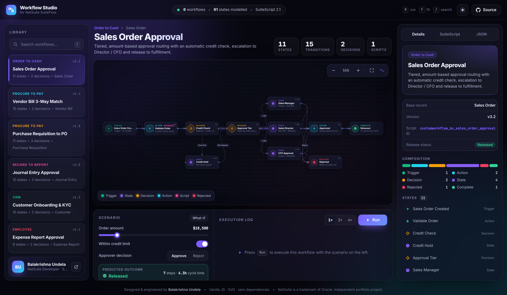
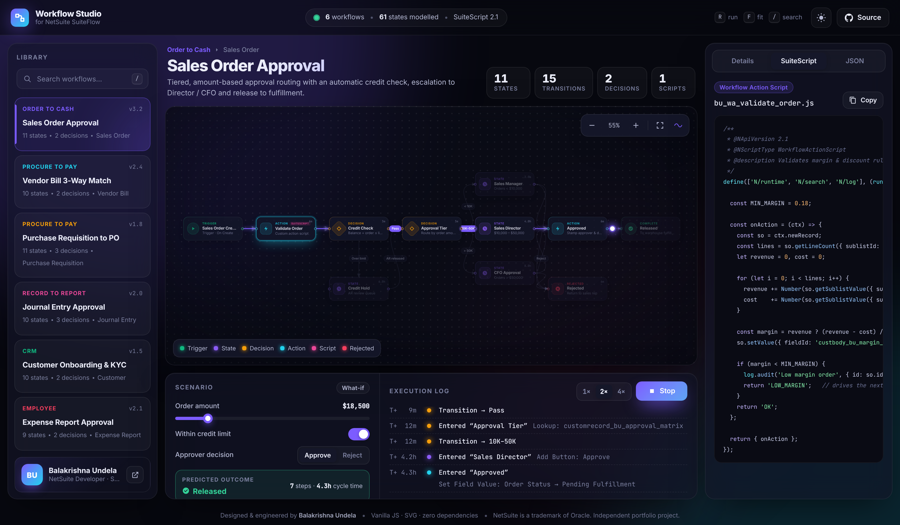
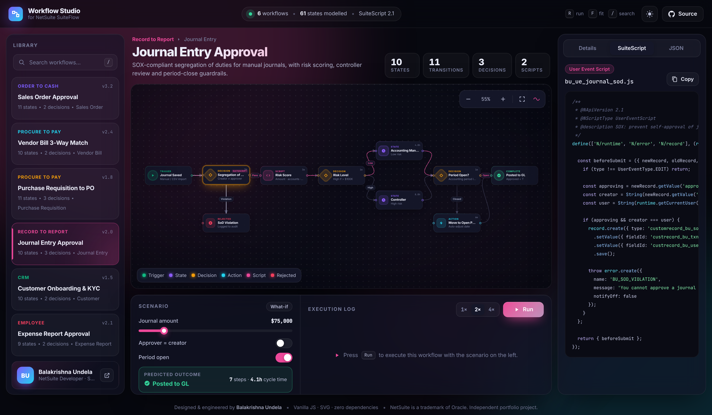

<div align="center">

# ⚡ NetSuite Workflow Studio

**An interactive visualizer and simulator for NetSuite SuiteFlow workflows, built on real SuiteScript 2.1.**

[](https://balakrishna-dev.github.io/netsuite-workflows/)




</div>

---

## ✨ What is this?

NetSuite workflows usually live inside the SuiteFlow editor, where only admins can see them. **Workflow Studio** turns six real-world business processes into an **interactive, explorable product**. You can:

- 🗺️ **Explore** each workflow on a pannable, zoomable canvas. You can drag states around to rearrange the diagram.
- 🎛️ **Ask what-if questions.** Change the order amount, credit status or approver decision and the *predicted path* lights up as you go.
- ▶️ **Simulate** a live run: a token moves along each transition while the execution log records SLA timing for every step.
- 🔍 **Inspect** any state to see its trigger, actions, SLA and incoming and outgoing transitions.
- 💻 **Read the SuiteScript** behind custom actions, with syntax highlighting and one-click copy.
- 📦 **Export** any workflow definition as JSON.

## 🧩 Workflow Library

| # | Workflow | Domain | Highlights |
|---|----------|--------|------------|
| 1 | **Sales Order Approval** | Order to Cash | Credit check, approval matrix with 3 tiers, CFO escalation |
| 2 | **Vendor Bill 3-Way Match** | Procure to Pay | PO ↔ Receipt ↔ Bill matching in SuiteQL, tolerance rules, AP exception loop |
| 3 | **Purchase Requisition to PO** | Procure to Pay | Budget vs. actuals, approval by hierarchy limit, RFQ sourcing |
| 4 | **Journal Entry Approval** | Record to Report | SOX segregation of duties, risk scoring, period-close guardrail |
| 5 | **Customer Onboarding & KYC** | CRM | External KYC API (`N/https`), tax validation, credit tiers |
| 6 | **Expense Report Approval** | Employee | Receipt enforcement, policy engine, ACH reimbursement |

## 📸 Screens

| Live simulation | State inspector |
|---|---|
|  |  |

## 🛠️ SuiteScript Included

```
suitescript/
├── workflow-actions/
│   ├── bu_wa_validate_order.js      # Margin & discount validation
│   ├── bu_wa_three_way_match.js     # SuiteQL 3-way match with tolerance
│   ├── bu_wa_budget_check.js        # Department budget vs. actuals
│   └── bu_wa_kyc_verify.js          # External KYC / sanctions screening
├── user-events/
│   └── bu_ue_journal_sod.js         # SOX: block self-approval + audit trail
└── map-reduce/
    └── bu_mr_approval_escalation.js # SLA breach escalation & delegate reassignment
```

Patterns shown: `N/query` SuiteQL, Workflow Action return values that drive transitions, script parameters for configuration without hard-coding, governance-aware Map/Reduce stages, error handling with `N/error`, and audit logging.

## ⌨️ Keyboard Shortcuts

| Key | Action |
|-----|--------|
| `R` | Run or stop the simulation |
| `F` | Fit the diagram to the screen |
| `1`–`6` | Switch workflow |
| `/` | Search the library |
| `T` | Toggle light / dark theme |
| `+` / `-` | Zoom |
| `Esc` | Clear the selection |

## 🚀 Run Locally

No build step and no dependencies.

```bash
git clone https://github.com/balakrishna-dev/netsuite-workflows.git
cd netsuite-workflows
npx http-server .        # or just open index.html
```

Every push to `main` is published automatically with **GitHub Pages**.

## 🏗️ Architecture

```
index.html               → app shell (library · canvas · simulator · inspector)
assets/css/style.css     → design system: tokens, glassmorphism, light/dark themes
assets/js/workflows.js   → workflow definitions (states, transitions, conditions, scripts)
assets/js/app.js         → SVG renderer, pan/zoom, drag, simulation engine, inspector
workflows/*.json         → portable exported definitions
```

- **Rendering:** states are HTML nodes and transitions are cubic Bézier SVG paths, recomputed live while you drag.
- **Simulation engine:** walks the graph using each transition's condition `(scenario, ctx) => boolean`, with visit counters so retry loops (for example *Exception → Re-match*) finish.
- **Accessible:** keyboard navigable, ARIA roles, respects `prefers-reduced-motion`, responsive down to phone width.

## 👤 Author

**Balakrishna Undela**, NetSuite Developer (SuiteScript · SuiteFlow · SuiteQL · Integrations)

[](https://github.com/balakrishna-dev)

---

<sub>NetSuite is a trademark of Oracle Corporation. This is an independent portfolio project and is not affiliated with Oracle.</sub>
